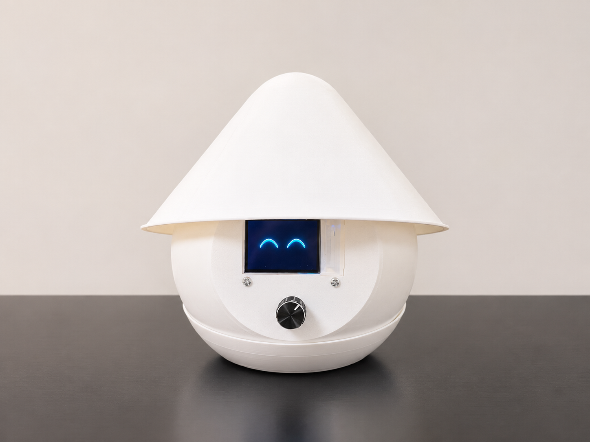

# The Missing Minutes

Repository: [yanz24373-hub/The-Missing-Minutes](https://github.com/yanz24373-hub/The-Missing-Minutes)

An interactive robotic companion for everyday departure routines. A rotary encoder sets the departure time, the display presents one preparation task at a time, and a head touch acknowledges completion. Light and hat movement provide reminders. A separate wireless key tray reports key presence and plays audio events.



## Start here

- [System architecture](docs/figures/system-architecture.svg)
- [Hardware connections and power notes](hardware/CONNECTIONS.md)
- [Firmware setup and operation](docs/SETUP.md)
- [Runtime flowchart](docs/figures/runtime-flowchart.svg)
- [Wireless protocol](docs/PROTOCOL.md)
- [Technical appendix (two-page PDF)](docs/Appendix_E_Technical_Documentation.pdf)
- [3D models and part list](models/README.md)

## Repository structure

```text
firmware/
  ESP32_Main/       Main robot sketch and Wi-Fi configuration example
  ESP8266_Tray/     Key-tray/audio sketch and Wi-Fi configuration example
hardware/          GPIO mapping, wiring diagram and power notes
models/
  stl/             Six supplied printable meshes
  cad/             Rhino model (shybo.3dm)
docs/              Setup, protocol, architecture, flowchart and appendix
media/             Two supplied robot photographs
```

## Hardware and software

The ESP32 controls an ST7735 TFT, rotary encoder, digital head-touch input, servo and 33 WS2812-compatible LEDs. The ESP8266 reads an analogue pressure sensor and controls a DFPlayer Mini over software serial. The speaker connects to the DFPlayer. Both controllers join the same 2.4 GHz Wi-Fi network and exchange UDP packets.

Arduino libraries: **Adafruit GFX Library**, **Adafruit ST7735 and ST7789 Library**, **Adafruit NeoPixel**, **ESP32Servo**, and **DFRobotDFPlayerMini**. The ESP8266 sketch also uses **SoftwareSerial** from the ESP8266 environment. Wi-Fi, UDP, HTTP, secure client and time support are supplied by the relevant board cores. See [setup](docs/SETUP.md) for board selection and configuration.

## Source and scope

The two supplied sketches are preserved byte for byte, organised into Arduino-compatible folders. Pin assignments and behaviour in the documentation are derived from these sketches. Board-core/library versions, physical power distribution, exact module revisions, and printed-part settings are not recorded in the supplied files. This package has not been compiled or tested on hardware during documentation preparation.

The MP3 assets referenced by the tray firmware are not included. Supply `/mp3/0001.mp3`, `0002.mp3` and `0003.mp3` on the DFPlayer microSD card for warning, overdue and completion audio.

Participant consent forms and other identifiable study records are not included in this technical repository. Wi-Fi credentials belong only in ignored local `wifi_secrets.h` files. No open-source licence has been assigned to the supplied code, models or photographs.
