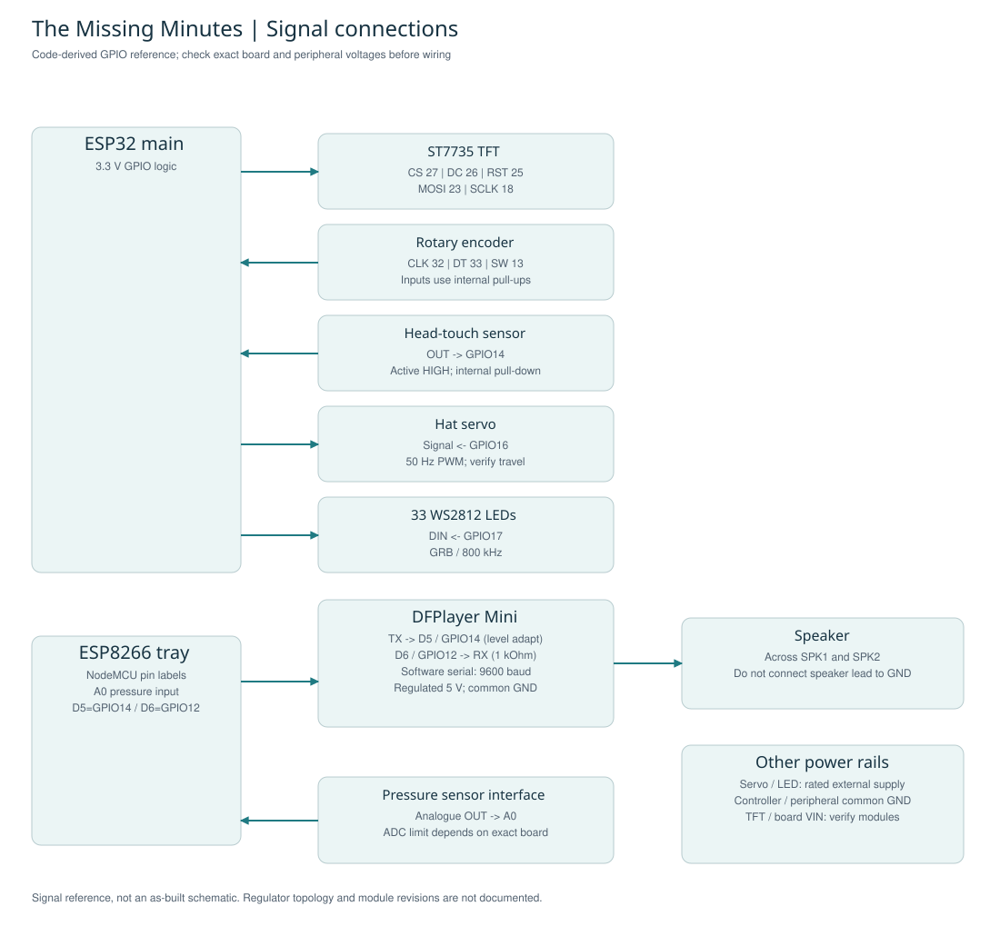

# Hardware connections

This mapping follows the supplied firmware. The signal diagram is a code-derived connection reference, not a verified as-built electrical schematic. GPIO numbers are ESP chip GPIO numbers; D5/D6 are NodeMCU labels.

## ESP32 main robot

| Module | Module signal | ESP32 GPIO | Interface / behaviour |
|---|---|---:|---|
| ST7735 TFT | CS | 27 | Chip select |
| ST7735 TFT | DC | 26 | Data / command |
| ST7735 TFT | RESET | 25 | Reset |
| ST7735 TFT | MOSI / SDA | 23 | Software SPI data |
| ST7735 TFT | SCLK / SCL | 18 | Software SPI clock |
| Rotary encoder | CLK | 32 | INPUT_PULLUP |
| Rotary encoder | DT | 33 | INPUT_PULLUP |
| Rotary encoder | SW | 13 | INPUT_PULLUP; switch to GND |
| Digital head-touch sensor | OUT | 14 | INPUT_PULLDOWN; active HIGH |
| Hat servo | Signal | 16 | 50 Hz; 1000-2000 us attach range |
| WS2812-compatible LEDs | DIN | 17 | 33 LEDs; GRB at 800 kHz |

No TFT MISO is configured. The firmware sets the servo to 90 degrees and moves through approximately 60 and 120 degrees. Confirm mechanical clearance before powering the mechanism. The source files do not identify the servo part number, TFT supply/backlight circuit or touch-module model.

## ESP8266 key tray and audio

| Module | Connection | ESP8266 / destination | Notes |
|---|---|---|---|
| Pressure sensor interface | Analogue OUT | A0 | ADC input; calibrate for the actual board |
| DFPlayer Mini | TX | D5 / GPIO14 (software RX) | Use suitable 3.3 V level adaptation as specified in the sketch |
| DFPlayer Mini | RX | D6 / GPIO12 (software TX) | Sketch specifies a series 1 kOhm resistor |
| DFPlayer Mini | VCC | Regulated 5 V | Share GND with ESP8266 |
| Speaker | Two speaker leads | DFPlayer SPK1 and SPK2 | Sketch specifies an 8-ohm speaker; neither lead to GND |

The pressure sensor part number, divider resistor and supply are not specified. The ESP8266 chip ADC and development-board A0 inputs can have different voltage ranges. Check the exact board and keep the input within its rated range; never connect 5 V directly to A0. Default thresholds are presence ON >=300, OFF <=150, with 700 ms stability and eight-sample averaging.

## Power and ground

- ESP32/ESP8266 GPIO logic is 3.3 V. Sensor outputs and peripheral inputs must be compatible or level shifted.
- Use a regulated supply matched to the actual servo and LED hardware, with enough current for peak load. Do not power a servo or LED strip from a GPIO.
- Share ground between each controller and its wired peripherals. The wireless link itself needs no signal wire between controllers.
- The provided files specify 5 V for the DFPlayer. They do not establish the actual ESP board VIN supply, TFT VCC, servo VCC, LED VCC or regulator arrangement; check the fitted modules before wiring.
- Check the LED manufacturer's logic-level requirements; use appropriate data-level adaptation if a 3.3 V output is insufficient.

These power notes describe conditions for a reproducible build, not measurements of the photographed prototype.
